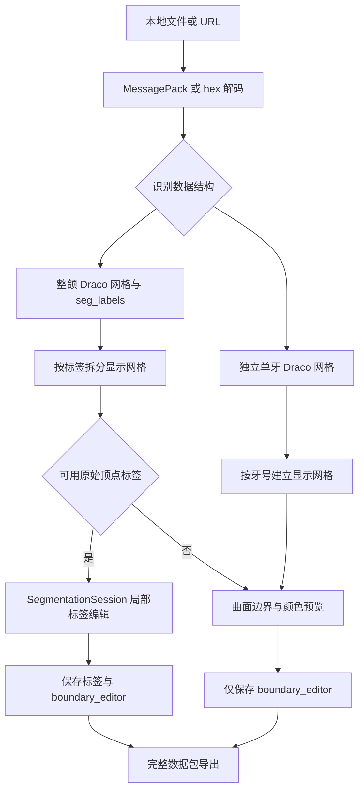
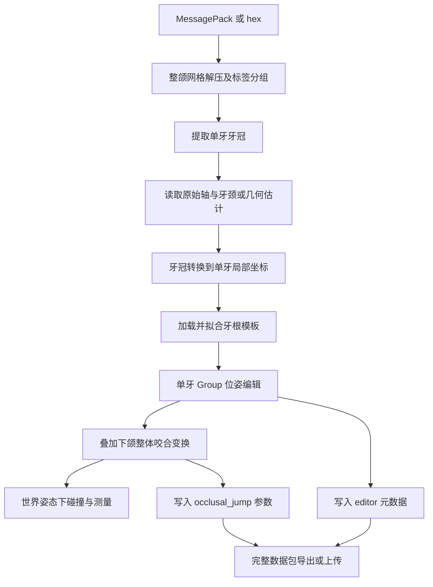

# 牙齿模型页面：数据、技术与算法说明

编写日期：2026-10-27。本文以当前工作区源码为依据，包含尚未提交的实现；描述的是代码行为，不构成临床算法验证报告。

分析入口：

- [msgpackTeeth/index.vue](../src/page/msgpackTeeth/index.vue)：牙颌数据加载、分区显示、边界编辑及完整数据导出。
- [toothRoots/index.vue](../src/page/toothRoots/index.vue)：牙根模拟、单牙位姿编辑、咬合调整、碰撞与几何测量。

两个 Vue 文件主要负责页面状态、交互和场景调度。实际数据解析及几何计算分布在同目录工具模块中，本文将这些直接依赖一并纳入说明。已有 README 仅作为背景资料；与当前实现存在差异的描述以源码为准。

## 1. 功能定位与整体数据流

| 对比项 | msgpackTeeth | toothRoots |
| --- | --- | --- |
| 主要目标 | 查看分割结果，调整牙齿边界 | 模拟牙根，调整牙齿及整体下颌姿态 |
| 模型输入 | 整颌分割网格，或独立单牙网格字典 | 当前安装流程要求 `lower_seg` / `upper_seg` 整颌分割数据 |
| 编辑对象 | 原顶点标签，或仅边界预览 | 单牙 Group 位姿、根模板参数、下颌整体变换 |
| 核心输出 | 完整 MessagePack / hex，含标签及边界编辑元数据 | 完整 MessagePack，含单牙 editor 与咬合参数 |
| 原始压缩网格 | 保留，不重新 Draco 编码 | 保留，不将位姿烘焙回原网格 |
| 计算特点 | 曲面路径、拓扑分区、局部标签量化 | 坐标系恢复、模板形变、刚性变换、BVH 查询 |

### 1.1 msgpackTeeth 流程



### 1.2 toothRoots 流程



## 2. 数据设计

### 2.1 文件格式与几何表达

外层 MessagePack 保存病例对象、二进制网格、标签、坐标轴及编辑信息；hex 是同一 MessagePack 字节流的十六进制文本表达。两个页面均支持完整 hex 字节序列，包括空白及可选 `0x` 前缀。

几何解码后采用 Three.js `BufferGeometry`：

| 数据 | 表达 | 含义 |
| --- | --- | --- |
| 顶点坐标 | `position`，每项 XYZ | 模型坐标中的点 |
| 三角索引 | 可选 `index`，每组三个整数 | 引用三个顶点组成三角面 |
| 无索引几何 | 连续三个顶点组成一面 | 三角形汤，顶点可能重复 |
| 法线 | `normal` | 光照及显示插值；缺失时计算 |
| 分割标签 | `seg_labels` | 与解压后的顶点或三角面顺序一一对应 |

`msgpackTeeth` 的网格读取要求真实 `DRACO` 文件头。支持直接 bin，以及 `type` 为 `drc`、`drcp`、`dcrp` 的 `{ type, data }` 包装。传给 Draco Worker 前复制精确字节区间，避免转移底层 ArrayBuffer 时影响原数据包。

`toothRoots.decodeSurface` 额外支持 float32：

- XYZ 为小端序，每点 12 字节，通过 DataView 读取，兼容不按 4 字节对齐的 bin 偏移。
- 自动模式识别 `DRACO` 头，或明确的 `mesh.type === 'float32'`；其他情况需要用户显式选择 float32。
- 有 `mesh.indices` 时校验整数范围和三角索引长度。
- 无索引时要求每 9 个浮点数构成一面，不从点云猜测表面拓扑。

### 2.2 主要业务字段

下面为结构示意，各可选字段不要求同时存在：

```text
payload
├─ lower_seg / upper_seg
│  ├─ mesh
│  │  ├─ type
│  │  ├─ data                    二进制网格
│  │  └─ indices                 float32 模式可选
│  └─ seg_labels                 顶点标签或面标签
├─ lower_teeth / upper_teeth
│  └─ "牙号"
│     ├─ type / data             已有独立单牙网格时使用
│     └─ editor                  toothRoots 写入的编辑状态
├─ lower_gum / upper_gum
│  ├─ gum                        可选牙龈网格
│  └─ tooth_boundary_dict
│     └─ "牙号"                  原始牙颈 XYZ 闭环
├─ lower_axis / upper_axis
│  └─ "牙号"                     单牙坐标变换矩阵 bin
├─ boundary_editor               msgpackTeeth 的边界编辑信息
├─ occlusal_jump                 toothRoots 的下颌整体调整参数
└─ 其他原始字段                   随完整数据包保留
```

`msgpackTeeth` 也支持简化顶层 `{ mesh, seg_labels }`，以及手动填写点分隔字段路径。自动识别时优先 `{jaw}_seg`，没有分割对象才使用 `{jaw}_teeth`，独立单牙字典的键作为牙号。仅包含附件等未知结构的数据包会报错。

`toothRoots.install` 当前只遍历上下颌的分割对象；`{jaw}_teeth` 在该流程主要承载已有单牙信息和编辑元数据，不能仅凭独立单牙字典完成加载。

### 2.3 标签规则与牙号

标签支持整数数组或 Uint8Array。bin 在这里表示每标签一个字节，不自动解析多字节整数数组或 NumPy 标签布局。

设顶点数为 `V`，三角面数为 `F`，标签数为 `L`：

| 模式 | 要求 | 处理 |
| --- | --- | --- |
| vertex | `L = V` | 从顶点标签决定原有三角面的归属 |
| face | `L = F` | 每面直接归属对应标签 |
| auto | 根据长度判断 | 若 `V = F = L`，要求明确选择模式 |

顶点模式下，三角面的三个标签记为 `a,b,c`，代码规则为：

```text
faceLabel = (b == c) ? b : a
```

这等价于多数归属，三者各异时取首顶点标签。它只分组已有三角面，不生成沿标签边界的真实切口。显示副本可以变成非索引几何，但原始标签索引仍对应解压后的原网格。

`msgpackTeeth` 将标签 0 作为背景 / 牙龈。`toothRoots` 对牙冠要求有效 FDI 牙位：上颌 11–18、21–28，下颌 31–38、41–48；其他非零标签不作为可编辑牙冠。

**关键前提：标签顺序必须与 Draco 解压后的顺序一致。长度校验不能发现排列错误；数据生产端需同步标签重排或提供映射。**

### 2.4 三层状态

| 状态层 | msgpackTeeth | toothRoots |
| --- | --- | --- |
| 原始数据层 | `cachedPayload`；失败候选暂存 `pendingPayload` | `source` 完整解码对象 |
| 编辑计算层 | 分颌 / 字段路径会话、原始标签、当前标签、历史、控制点 | `Tooth[]`、原始基准、当前位姿、根参数、咬合参数 |
| 显示层 | 标签 Mesh、曲面颜色副本、边界 Scene | 牙冠 / 根 Group、辅助图层、碰撞和测量标记 |

三层分离使显示几何可重建，同时保留原始网格字节。注意：`msgpackTeeth` 的顶点编辑会主动改写缓存数据中的标签；`toothRoots` 的位姿操作先保存在对象状态，导出或上传时才生成快照。

### 2.5 坐标、单位与精度

- 模型坐标沿用输入，未自动认定单位为毫米；牙根长度、平移、间隙和测距均使用模型单位。
- `toothRoots` 保留 `align_matrix` 等原始字段，不猜测其布局并额外应用，也不额外应用含义未经确认的咬合矩阵。
- 单牙 `baseFrame` 为 16 元素列主序矩阵，表示单牙局部坐标到模型坐标。
- 保存位置为 XYZ，四元数为 `[x,y,z,w]`。
- `toothRoots` 的 MessagePack 编解码使用 `useBigInt64: true`；`msgpackTeeth` 使用默认编解码选项，不能据此宣称两个页面都保证未知 64 位整数无损。
- 完整导出保留对象中的其他字段与原网格字节，但 MessagePack 重新编码后的整体字节布局不承诺与输入一致。

## 3. 技术实现

### 3.1 技术栈

以下版本是 package.json 中的依赖范围，不代表本次重新核实的安装版本。

| 技术 | 声明版本 | 页面中的用途 |
| --- | --- | --- |
| Vue | `^3.5.22` | Composition API、响应式状态、生命周期 |
| TypeScript | `~5.9.0` | 几何及编辑数据类型 |
| Three.js | `^0.181.2` | 网格、材质、相机、射线拾取、矩阵与渲染 |
| @msgpack/msgpack | `^3.1.3` | 完整数据包编解码 |
| three-mesh-bvh | `^0.9.9` | 曲面投影、空间查询、相交与距离检测 |
| Vite | `^7.1.7` | 开发及构建 |
| Playwright | `^1.58.2` | 仓库中的核心逻辑和页面验证用例 |

Draco 解码资源来自 `public/draco/`。牙根模板默认来自 `public/root-templates/{FDI}.obj`，也支持符合约定的 PLY。

### 3.2 模块分工

| 页面 | 模块 | 责任 |
| --- | --- | --- |
| msgpackTeeth | `geometry.ts` | 字段读取、结构诊断、颌位识别、标签拆分 |
| msgpackTeeth | `segmentation.ts` | 文件编解码、原始标签会话、边界提取、标签提交与重置 |
| msgpackTeeth | `boundaryEditor.ts` | 边界控制点、拾取、拖动与回退 |
| msgpackTeeth | `previewSurface.ts` / `cachedSurfacePath.ts` | 参考表面、贴面路径与缓存 |
| msgpackTeeth | `surfacePartition.ts` / `boundaryRegionColors.ts` | 曲面显示单元划分、连通分区和颜色预览 |
| msgpackTeeth | `boundaryPersistence.ts` | 校验、准备和恢复边界元数据 |
| toothRoots | `core.ts` | 数据解码、牙齿提取、坐标轴、根拟合、保存与上传顺序 |
| toothRoots | `occlusalJump.ts` | 下颌整体调整坐标系与刚性矩阵 |
| toothRoots | `collision.ts` | BVH 缓存、牙冠相交与最近距离 |
| toothRoots | `measurements.ts` / `sectionView.ts` | 邻牙间隙、测距、三维切片与二维投影 |
| toothRoots | `crownClosure.ts` | 牙轴查看模式的显示封口 |
| toothRoots | `inspection.ts` | 数据检查与点数组解析 |

曲面路径和面区域分类还复用了 `toothSegmentationTest/utils` 下的 `surfaceBoundaryUtils.ts`、`surfaceFacePathUtils.ts`、`toothRegionClassifier.ts` 等工具。

### 3.3 交互与渲染

两个页面均使用 OrbitControls 实现视角旋转、缩放和平移，使用 Raycaster 将屏幕交互映射到模型。

`msgpackTeeth` 在拖动边界时暂停相机控制，优先吸附牙齿 / 牙龈表面，未命中时使用拖动平面。模型与边界分 Scene 渲染；当前 `renderBoundaryOverlay` 第二次渲染保留模型深度，边界材质开启深度测试，因此背面边界受遮挡。

`toothRoots` 通过 Ctrl 拾取牙冠 / 牙根或牙号按钮选牙，使用局部 X/Z 轴平移和绕局部 Z 的红弧旋转。拖动使用 pointer capture，取消拖动恢复起点位姿。Shift 点击原牙冠表面用于两点测距。

模型加载采用先准备、再安装的方式，关键解析失败时保留当前可用模型。场景切换与卸载时释放几何、材质、控制器等资源；`msgpackTeeth` 还使用 AbortController 处理资源请求。

## 4. msgpackTeeth 核心算法

### 4.1 初始边界提取

存在可编辑原始顶点标签时，`SegmentationSession` 从标签交界提取边界：

1. 遍历三角面，忽略三个顶点标签相同的面。
2. 对每个正标签，在标签内外相接的边上取中点。
3. 两种标签的面连接两个交点；三种标签的面使用面重心连接分界。
4. 建立边界图，追踪节点度数为 2 的闭环。
5. 每牙保留周长最大的有效闭环。

没有可编辑顶点标签时，优先读取 `{jaw}_gum.tooth_boundary_dict[牙号]`，缺失时按坐标量化焊接显示网格顶点，统计三角边出现次数，取仅出现一次的开放边并追踪最长有效闭环。

因此，顶点编辑路径下的初始边界来自当前标签，而不是直接使用原始 tooth_boundary_dict。边界不存在或不能闭合时会提示缺失，不为该牙伪造可编辑轮廓。

### 4.2 控制曲线与贴面路径

顶点标签编辑使用闭合的 centripetal Catmull–Rom 曲线，初始控制点按闭环弧长均匀采样，最多 20 个。曲线采样数取 `max(64, 控制点数 × 8)`，去除重复闭合端点后，再投影并连接成三角面约束的曲面路径。

非顶点预览保留原始密集轮廓：控制点位移在相邻控制锚点间线性插值，再将更新后的轮廓吸附到参考表面。预览投影忽略退化三角面，并对坐标使用 Float32 精度对齐，减少保存后重建路径的不一致。

`createCachedSurfacePath` 缓存上一次有效拟合的点投影和有向路径段。仅复用坐标完全一致的条目；拟合失败不覆盖旧缓存。它减少重复计算，但不能保证每次拖动只更新两段，因为曲线采样位置本身可能同时改变。

### 4.3 原始顶点标签的局部重分类

`SegmentationSession` 先构建原网格面邻接和顶点邻接关系，并在原边界周围建立默认 **4 圈相邻面** 的编辑带。随后通过图遍历选取可靠的牙内面种子，以及同一表面连通分量中的外部种子。

松手提交时：

1. 检查新曲面路径是否处于允许编辑面范围内。
2. 将曲面路径作为面邻接图上的通行屏障，阻断被边界穿越的邻接连接。
3. 按连通分量分类，以牙内种子所在区域作为牙齿侧。
4. 校验内外种子被分隔，且未连接到原来的可靠外部区域。
5. 汇总顶点相邻面的内部票数，将连续分区量化为离散顶点标签。
6. 仅修改编辑带内顶点；被释放的牙齿顶点通过顶点图上的多源传播，恢复到原始非目标牙标签。

设某顶点相邻面的总数为 `t`，其中内部面数为 `v`：

```text
2v > t：归入当前牙齿
2v < t：位于边界外侧
2v = t：保留当前是否属于该牙的状态
```

提交前先生成显示分区并校验标签写入条件，再更新会话、持久化边界和替换显示网格。超出局部范围、内外不可靠、跨越内部种子等情况拒绝修改。

重置使用逐顶点的编辑历史，移除所选牙造成的记录，尽量保留其他牙的编辑结果。这里是边界约束的拓扑分类和投票；该页面没有调用 Graph Cut 来执行这次边界提交。

### 4.4 无可编辑顶点标签时的颜色预览

当前实现使用曲面分区生成显示几何，并非旧 README 所述的固定平面片元着色方案：

1. 建立参考表面，并记录每个参考面来自哪颗牙或牙龈。
2. 将贴面边界段关联到原始三角面。
3. 用这些线段在三角面内划分多边形显示单元 `SurfaceCell`。
4. 建立单元邻接；跨边界的连接被阻断。
5. 对单元做连通分量标记，并累计有向边界左右侧的长度权重。
6. 初始按目标牙覆盖面积确定牙齿侧，后续保持边界方向对应的内外侧。
7. 将显示单元三角化，使用重心坐标插值法线；目标牙内侧使用牙色、外侧使用牙龈色，扩展到牙龈的内部区域通过覆盖网格显示。

算法会检查多个内部区域、内外未分隔及新增跨入其他牙齿区域等情况。对于输入本来就存在的外牙重叠区域，记录初始多边形覆盖，避免将既有重叠误判为新编辑。

该过程可增加显示副本的顶点与三角面，**不修改原始 Draco 网格，也不把面标签转成可编辑的顶点标签**。

### 4.5 边界保存协议

当前源码已支持完整导出及重新加载恢复边界：

```text
boundary_editor = {
  version: 1,
  scopes: {
    "颌位:网格字段路径|标签字段路径": {
      "牙号": {
        kind: "vertex" 或 "preview",
        points: [[x,y,z], ...],
        controls: [[x,y,z], ...]
      }
    }
  }
}
```

`points` 保存基准轮廓，`controls` 保存编辑控制点；预览模式以此恢复颜色及边界。顶点模式还会写入对应 `seg_labels`。写入前校验长度、非负整数及单字节标签范围；不兼容的 boundary_editor 结构会被拒绝覆盖。

保存的是整个 payload，原始 `mesh.data` 保留，独立单牙网格不会随标签变化重新生成。内存中切换颌位可复用会话；重新打开导出文件通过标签和元数据恢复状态，但不承诺恢复上一运行期完整的撤销历史。

## 5. toothRoots 核心算法

### 5.1 单牙提取与牙颈选择

`extractTeeth` 复用 `splitByLabels` 提取原有牙冠三角面的副本，保留对应原顶点索引集合。顶点模式记录属于该牙的原始顶点；面模式记录该牙各面引用顶点的并集。

牙颈优先使用原始 tooth_boundary_dict。缺失时对牙冠副本坐标按 `1e-5` 尺度量化焊接，统计开放边，拒绝分叉或未闭合的边界分量。多个闭环存在时按根向上环中心的投影排序；未给方向时按点数排序。没有可靠闭环则保留牙冠并跳过牙根。

### 5.2 原始轴恢复与几何估计

优先读取 `{jaw}_axis[牙号]`：

1. bin 尾部必须有 `|4,4,<f8` 或 `|4,4,<f4` 元数据。
2. 按小端序读取 16 个数，校验长度、有限值、仿射矩阵末行。
3. 检查旋转基向量正交、单位长度和行列式接近 1，拒绝缩放 / 镜像。
4. 输入为行主序的“模型 → 单牙局部”变换，转置适配 Three.js 后求逆。
5. 从逆矩阵取原点和方向；当前数据约定原第二方向为长轴，显示 X 取原第一方向，显示 Z 取原第二方向，Y 取 `Z × X`。
6. 按牙颈指向牙冠的提示修正 Z 正负，保持右手坐标系；根向为显示 −Z。

轴缺失或无效时采用几何估计：

```text
c = 唯一牙冠顶点平均位置
C = Σ (pi - c)(pi - c)^T
```

对对称协方差矩阵做 Jacobi 特征分解，最多 30 次迭代。在三个特征方向中选择与“牙颈 → 牙冠”提示方向绝对点积最大的方向作为 Z，再修正正负。这不是简单选择最大特征值方向，目的是减少宽磨牙横向被误当长轴的情况。

按 FDI 牙弓顺序取邻牙中心方向 `d`，构造局部坐标：

```text
X = normalize(d - Z × dot(d,Z))
Y = normalize(Z × X)
```

若邻牙方向投影退化，则依次用世界 X/Y 方向投影作为备用。

### 5.3 局部牙冠与位姿恢复

设原始局部到模型的基准矩阵为 `B`，原牙冠点为 `p`：

```text
p_local = inverse(B) × p
```

牙冠副本变换到局部坐标，牙冠与模拟根挂在同一个 Group 下。Group 初始位姿为 `B`，因此显示位置与原模型一致。编辑只改变 Group 位姿，原始压缩顶点不发生变化。

v2 保存后恢复时使用：

```text
P_restore = P_saved × inverse(B_saved) × B_current
```

这将已保存的编辑变换应用到当前基准，减少轴计算方法变化导致的漂移。v1 数据使用旧开放边 / PCA 基准兼容恢复，下次保存可升级为 v2。

### 5.4 牙根模板拟合

模板采用单位约定：颈圈位于 `z=0`，径向单位半径为 1，根尖位于 `z=-1`。OBJ 要求一个网格，多根可以放在同一个网格中。

拟合过程：

1. 求局部牙颈点的平均中心 `c`。
2. 按 `atan2(y-cy,x-cx)` 排序牙颈轮廓，得到按角度查询的边界。
3. 对模板每个顶点，计算其半径 `r` 和角度，在相邻牙颈轮廓点间插值得到边界点 `e`。
4. 从牙颈最大 X/Y 偏移取得椭圆缩放半径 `Rx,Ry`。
5. 只在根颈上部 25% 混合轮廓贴合，下方保留模板缩放形状。

对应简化公式如下，`z` 为模板原始高度，`L` 为根长：

```text
w = max(0, 1 + z / 0.25)
x' = lerp(cx + x·Rx, cx + (ex-cx)·r, w)
y' = lerp(cy + y·Ry, cy + (ey-cy)·r, w)
z' = cz + z·L + (ez-cz)·w
```

随后只对生成的牙根焊接顶点并重算法线，不焊接或改写原始口扫网格。默认根长按牙位个位映射为 `[12,12,16,14,13,13,12,11]`，属于模型单位参数。

该拟合要求牙颈相对中心近似星形。仓库默认根模板为程序生成的示意形状，不是根据患者影像重建的真实牙根，也未实现 ICP 或复杂非刚性配准。

### 5.5 整体下颌咬合调整

参数为前后 `forward`、左右 `lateral`、上下 `vertical` 和张口角 `opening`。前三项范围 −20～20 模型单位，张口角范围 0～30°。

坐标框架由原始下颌位姿固定估计：

- 转轴中心优先取磨牙原始中心平均，无磨牙时取所有下颌牙中心平均。
- up 取各下颌牙原始局部 Z 方向的平均。
- front 优先取磨牙中心指向切牙中心并投影到 up 的正交平面。
- right 为 `normalize(front × up)`。

设位移向量为 `s`、转轴中心为 `c`，则：

```text
s = forward·front + lateral·right + vertical·up
J = T(c+s) × R(right, -opening) × T(-c)
```

角度计算前转换为弧度。该刚性变换作用于下颌父节点 lowerMotion，带动下颌牙冠、根及辅助图层。单牙编辑保留为父节点内部的局部位姿，因此下颌牙冠显示可写为：

```text
p_display = J × P_tooth × inverse(B) × p_original
```

“原始 / 调整后”对比临时切换 J 是否生效，不清除单牙编辑和已设置参数。它是几何张口模拟，未建立颞下颌关节生物力学模型。

### 5.6 咬合碰撞

碰撞使用原始牙冠显示副本和当前 `matrixWorld`，排除模拟牙根与辅助封口。

1. 使用世界轴对齐包围盒初筛，上牙包围盒按阈值扩展后与下牙比较。
2. 以几何对象为键缓存 `MeshBVH`，使用 `indirect: true` 保留原三角索引关系。
3. 构造相对矩阵 `inverse(M_upper) × M_lower`，将下牙转换到上牙局部框架。
4. BVH 双树遍历并测试三角面相交，收集实际相交面的索引。
5. 有相交则返回 `intersection`、距离 0，并生成红色面覆盖。
6. 无相交则查询最近表面点对，将点转回世界坐标，距离在阈值内返回 `near`，以黄色点线表示。

返回距离为无符号表面间隙，不是穿透深度。仅做表面相交和距离查询，不能据此推导重叠体积或完全包容关系。代码对作为参考的上牙世界变换检查正的均匀缩放，非均匀缩放不支持距离换算。

位姿、阈值或数据改变会使已有结果失效，页面要求重新检测。

### 5.7 测量与切片

| 工具 | 算法 | 输出和边界 |
| --- | --- | --- |
| 邻牙间隙 | 按固定 FDI 相邻顺序配对，BVH 查询最近表面点 | 跨中线配对；缺牙处不跨空位连接；无符号距离 |
| 两点测距 | Raycaster 获取原牙冠世界表面点，计算欧氏距离 | `d = sqrt(dx²+dy²+dz²)`；第三次取点开始新测量 |
| 咬合截面 | 将世界切片平面变换到各牙局部坐标，BVH 筛选并计算三角形与平面交线 | 显示交线及二维投影，不裁掉原模型 |

截面求交按平面有符号距离判断边跨越。边端点为 `a,b`、距离为 `da,db` 时，交点为 `a + (b-a) × da/(da-db)`。共面三角形跳过，交点与线段按容差去重。

默认切片法向取所选牙局部 X，因而包含局部长轴；也支持世界 X/Y/Z 方向及偏移。二维预览将交线点减去平面原点后，分别投影到平面两条基向量。

Bolton、拥挤度、Spee 深度等指标尚未在这些实现中形成计算输出，需要另行确定测量点、牙弓或参考平面。

### 5.8 牙轴查看的显示封口

`createCrownCap` 对显示副本做坐标焊接与开放边统计，识别简单闭环，估计轮廓法向并投影到二维，用 ShapeUtils 三角化后回用原三维边界坐标。

投影三角化不完整时使用中心扇形作为近似显示封口。分叉、非流形等未解决边界计入提示。封口是独立辅助网格，不参与原牙冠碰撞，也不写回原始网格或导出数据。

## 6. 保存、上传与页面之间的衔接

### 6.1 toothRoots 保存结构

每颗牙在 `{jaw}_teeth[牙号].editor` 下追加或合并：

```text
editor = {
  schema: "tooth-roots-v2",
  baseFrame: [16 个列主序矩阵元素],
  position: [x,y,z],
  quaternion: [x,y,z,w],
  root: { template: "31.obj", length: 12 }
}

occlusal_jump = {
  schema: "occlusal-jump-v1",
  parameters: { forward: 0, lateral: 0, vertical: 0, opening: 0 }
}
```

保存原始单牙字段和已有 editor 的其他元数据；未知的非字典 teeth 结构拒绝覆盖。保存的是姿态和模板参数，根表面可重新生成，不将生成的牙根作为新 Draco 网格写回。

即使正在查看“原始”对比，仍保存调整参数。旧文件没有 occlusal_jump 时按零调整加载，非法参数拒绝安装。

### 6.2 上传顺序

`toothRoots` 提供可配置适配器，调用顺序为：

```text
POST getUpdateEditVersion → POST getUploadPath → PUT 完整二进制 MessagePack → POST update
```

页面适配器使用病例 ID、编辑版本与文件 key；应用接口携带 credentials，存储 PUT 使用签名头。任一步失败即终止后续操作，只有最终更新成功才清除未保存标记。拖动不会自动上传，演示数据禁止上传。

仓库未提供这些业务接口的服务端实现，不能将页面可配置适配器视为已经完成生产服务联调。

### 6.3 两页面可衔接的部分与限制

| 场景 | 当前行为 |
| --- | --- |
| msgpackTeeth 修改顶点标签后交给 toothRoots | toothRoots 会按更新后的 seg_labels 重新提取牙冠 |
| msgpackTeeth 仅修改预览边界后交给 toothRoots | toothRoots 未读取 boundary_editor；仍读取原 tooth_boundary_dict 或开放边 |
| 修改标签同时仍有原始牙颈字典 | toothRoots 优先使用旧 tooth_boundary_dict，可能与新标签轮廓不一致 |
| toothRoots 保存后交给 msgpackTeeth | msgpackTeeth 保留 editor / occlusal_jump 数据，但当前页面不应用这些姿态 |
| 从独立单牙网格读取更新标签结果 | 独立网格未自动重新生成；应从整颌网格及更新标签重建 |

因此，两个页面共享数据容器与部分几何工具，但尚未形成统一的边界、单牙位姿和整体咬合显示协议。若用于连续业务流程，应先确定上述元数据的消费规则和优先级。

## 7. 性能与实现边界

- 标签分组、开放边统计和初始边界扫描以遍历网格为主，主要成本随三角面 / 顶点规模增长；显示分组复制坐标和法线，会增加内存占用。
- 曲面查询使用 BVH 和路径缓存减少重复计算，但预览分区仍会扫描参考表面及重建显示缓冲，复杂路径产生更多显示单元时成本上升。
- 顶点编辑限制了允许修改的局部范围；当前 rasterize 的投票等步骤仍遍历全网格，不能将其性能描述为仅与局部顶点数相关。
- 碰撞使用包围盒和 BVH 剪枝，实际耗时取决于牙对数量、网格密度与空间重叠；源码不提供固定帧率或耗时保证。
- PCA 轴估计、开放边牙颈、模板径向形变和张口转轴均含几何假设；无法从这些计算证明患者解剖结构或临床效果。

## 8. 源码索引与验证范围

以下是直接支撑本文的数据及算法入口：

| 主题 | 源码入口 |
| --- | --- |
| 分割输入与三角面归属 | [geometry.ts](../src/page/msgpackTeeth/geometry.ts)：readPayload / splitByLabels |
| 顶点边界与局部标签 | [segmentation.ts](../src/page/msgpackTeeth/segmentation.ts)：extractSegmentationBoundaries / SegmentationSession |
| 控制点与拖动 | [boundaryEditor.ts](../src/page/msgpackTeeth/boundaryEditor.ts)：ToothBoundary / BoundaryEditor |
| 曲面预览 | [previewSurface.ts](../src/page/msgpackTeeth/previewSurface.ts)、[surfacePartition.ts](../src/page/msgpackTeeth/surfacePartition.ts) |
| 颜色与深度遮挡 | [boundaryRegionColors.ts](../src/page/msgpackTeeth/boundaryRegionColors.ts)：BoundaryRegionColors / renderBoundaryOverlay |
| 边界持久化 | [boundaryPersistence.ts](../src/page/msgpackTeeth/boundaryPersistence.ts) |
| 牙轴、牙根、姿态 | [core.ts](../src/page/toothRoots/core.ts)：readStoredFrame / longAxis / fitRoot / saveDocument / restoreTooth |
| 咬合整体变换 | [occlusalJump.ts](../src/page/toothRoots/occlusalJump.ts)：jumpFrame / jumpMatrix |
| 碰撞 | [collision.ts](../src/page/toothRoots/collision.ts)：detectToothPair |
| 几何测量 | [measurements.ts](../src/page/toothRoots/measurements.ts)、[sectionView.ts](../src/page/toothRoots/sectionView.ts) |
| 显示封口 | [crownClosure.ts](../src/page/toothRoots/crownClosure.ts) |

仓库已有相关用例：

- `tests/msgpackTeeth.spec.ts`、`tests/msgpackSegmentation.spec.ts`、`tests/msgpackEditingPage.spec.ts`：数据读取、标签编辑及页面行为。
- `tests/msgpackSurfacePartition.spec.ts`、`tests/msgpackSurfaceColors.spec.ts`、`tests/msgpackCachedSurfacePath.spec.ts`：表面分区、颜色及缓存路径。
- `tests/toothRootsCore.spec.ts`、`tests/toothRootsPage.spec.ts`：单牙提取、姿态保存与页面操作。
- `tests/occlusalCollision.spec.ts`、`tests/occlusalJump.spec.ts`、`tests/toothMeasurements.spec.ts`、`tests/toothCrownClosure.spec.ts`：碰撞、整体变换、测量及封口。

本次仅新增说明文档，执行源码交叉核对与文档链接检查；未重新运行上述测试、真实样本验证或性能基准。已有测试文件的存在不代表本次运行通过。
